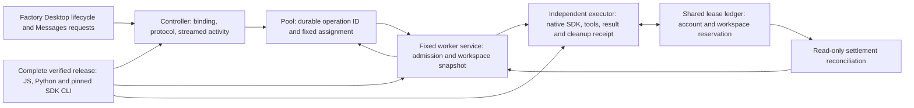

# Factory bridge reliability architecture

Decision date: 2026-11-07. Scope: the customised subscription Workstream bridge,
its worker services, shared admission scheduler and local release artifacts.

## Decision: improve the existing boundaries

Retain the existing protocol, operation IDs, executor ownership receipts, account
assignment and workspace isolation. Repair the dependency and settlement defects
at those boundaries. A rewrite has no demonstrated advantage for the observed
incident: it would need to recreate the same negative-case and recovery evidence,
while migrating active Factory sessions, worker histories and private configuration.
This is an architecture decision, not a claim that the bridge has been certified
for every provider, workload or Factory Desktop version.



The request body is model/tool data. Only the constrained host lifecycle binding
path selects a session. A model result is evidence of a model outcome; executor
cleanup and shared lease settlement are separate evidence layers. A healthy
HTTP endpoint or successful login does not establish remaining provider allowance.

## Incident findings and implemented changes

| Finding | Root cause | Repair and proof boundary |
| --- | --- | --- |
| Every profile fails login preflight | Required CLI 2.1.316 lived in the native updater's prunable version directory | Use the same digest-verified CLI 2.1.300 bundled with pinned SDK 0.3.300 for auth and execution. No latest-version discovery or alternate billing route. |
| team1/team4 remain in recovery after lease repair | Departed executor snapshots are stale while their exact shared lease records are already terminal | Read-only reconciliation checks previous verified cleanup, exact account/worktree/worker identity, original executor birth identity, terminal outcome, timestamps and absence of executor group/helper. It never releases an unknown live lease. |
| Startup hides all causes behind one message | A catch discards exceptions and prints a generic sentence | Fixed safe codes survive startup and pre-execution MCP rejection; raw CLI output and identities never enter those messages. |
| A terminal result can be counted as free while lease release is false | Pool used result state and cleanup without checking explicit unsettled lease evidence | Retain reservation and report the worker requiring recovery until settlement is confirmed. |
| Source and live admission limits disagree | Deployed JS contained an eight-slot overlay while source still used two slots | Derive the subscription eight-worker ceiling from the eight fixed profiles and apply it to pooled controller and worker services. Per-seat execution remains one. Non-pooled/API limits retain their existing settings. |
| Releases cannot be reconstructed reliably from one revision | Controller/workers/pool and Python files came from different releases and manually overlaid hunks | Package complete artifacts from a clean commit with a fresh build, lockfile install, runtime verification and full file/mode/link manifest. Reject overlays and escaping dependency links. |
| A 3.4 MB, ~1,433-message cold import exited about 2 s after verified login, twice, leaving no cause | Every SDK error result became a generic 502, the typed `terminal_reason` and `api_error_status` were discarded, and a stopped generation logged nothing. Imported tool calls lost their IDs, so large histories could not pair calls with results | Each stopped generation logs one `sdk_session_failed` record with code, lifecycle phase, allowlisted SDK reason/status, account, native generation and cold-import counts, never message text. `prompt_too_long` returns Messages-API style `400 invalid_request_error` with `recovery_action: compact_conversation` and is never replayed on another account. Imported calls carry their IDs; unanswered calls and failed results are marked. |

The former CLI deletion's initiating process was not identified. This incident
proves a missing dependency, not which updater or cleanup removed it. Provider
allowance exhaustion was not established by the generic startup failures.

## Invariants

- Each logical start has a stable operation ID and durable account assignment.
  Response loss triggers lookup on that assigned service, never blind replay.
- Unknown execution retains its reservation. Recovery requires matched evidence;
  timeout, absent PID or a model's assertion alone cannot authorize replacement.
- Cleanup confirmation precedes lease settlement. Model success never supplies
  process-cleanup evidence. The executor result remains distinct from settlement.
- Original snapshots and native lease records remain available for investigation.
  A reconciliation projection reports its own reason and terminal ledger timestamp.
- Private operator configuration selects identity and scope. Worker prompts cannot
  select credentials, expand workspace authority or activate another billing route.
- Queue activity reaches the SSE wire; cancellation, disconnect, retry and restart
  are lifecycle transitions with explicit results, not inferred from silence.
- Admission ceilings protect accounts and machine resources. Routing weights
  express assignment priority and never assert measured subscription entitlement.
- The native CLI and SDK remain unmodified. Changes in runtime compatibility need
  new positive and negative validation before becoming an accepted release.

## Local diagnostics

After `npm ci` and `npm run build:workers`:

```sh
node workers-dist/scripts/subscription-doctor.js --config /absolute/private/pool-config.json
```

The doctor constructs no daemon, writes no saved state and sends no model prompt.
It separates login, configuration and saved worker evidence, reports recovered
worker IDs, and labels remaining provider allowance unknown. It describes the
candidate's behaviour; it does not attest that running services use the candidate.

Admission capacity comes from the shared lease ledger that all ten services use.
The worker-lane limit is the `--max-running` value the bridge passes to the lease
helper; the ledger does not store it, so supply it explicitly:

```sh
/usr/bin/python3 -I -c 'import json,sys; sys.path.insert(0, sys.argv[1]); from native_runtime.reporting import report_jobs; r = report_jobs(sys.argv[2], max_running=int(sys.argv[3])); print(json.dumps({"capacity": r.get("capacity"), "warnings": r["warnings"]}, indent=2))' \
  /absolute/release/native-runtime /absolute/private/lease-state-root 8
```

`capacity` reports each lane's limit, occupied, free and waiting counts, queued
jobs blocked by their own busy account, each account's controller and worker lane
(`free`, `busy`, or `excluded_until_cleanup_verified` after uncertain execution),
the oldest queue wait and recent admission delays. An unsafe or symlinked state
root yields a warning and no capacity. It reads recorded states only;
the admission helper alone reconciles owner liveness. A controller's `/status`
`desktopJobs.queue` and `desktopJobs.accounts` show that process's queued and
running phases. Neither is service health, login, successful inference or
remaining provider allowance.

A stopped native generation writes one `sdk_session_failed` (or, for cancellation
and host exit, `sdk_session_stopped`) record to `bridge.jsonl`. `phase` is
`startup` (before identity verification completed), `prompted` (input sent, no
model output yet), `continuation` or `responding`. `terminalReason`,
`apiErrorStatus`, `resultSubtype` and `assistantError` are copied only from the
SDK's enumerated fields. `coldImport` holds counts and the content size.

## Release and rollback

Prepare from a clean committed source checkout, using its pinned lockfile:

```sh
npx tsx scripts/package-subscription-release.ts --output /absolute/new/release-directory
npx tsx scripts/package-subscription-release.ts --verify /absolute/new/release-directory
```

The artifact includes a fresh compiled `runtime`, tracked `native-runtime`, its
own production dependencies and a manifest binding the source commit/tree, lockfile,
CLI/SDK digest and executable file closure. There are no dependency symlinks to an
older release. The packager does not change LaunchAgents, hooks, private configs,
account logins, worker state or live pointers. Keep the artifact immutable after
verification. Manifest verification is an integrity check, not a vendor signature.

Before activation, inspect active executor identities and queued/uncertain work.
Existing executors retain the release that launched them. Never restart or kill an
owned worker to make a rollout easier. Prepare all ten service commands (controller,
pool and eight worker services) against one verified artifact, including the native
runtime paths in private configs. Drain only services whose work has settled, then
activate with the operator's authority and read back every command and artifact
hash. Keep the previous complete release and previous private configuration as the
rollback target. Do not roll back worker state or replay operation IDs.

After activation, verify authenticated service health, pool account observations,
queue admission, result delivery, cleanup and lease settlement independently.
Native Factory Desktop journeys and actual provider-backed inference remain
separate acceptance gates; do not label them passed from local CI or login status.

## Acceptance matrix

| Boundary | Required evidence |
| --- | --- |
| Packaged authentication | All eight configured identities verified without logging private auth state; native version pruning cannot affect candidate selection |
| Runtime failure isolation | Missing/corrupt/version-mismatched CLI, malformed status, wrong identity and mixed credentials fail before worker creation |
| Recovery | Exact terminal lease permits read-only settlement; changed account/workspace/birth/outcome, live helper/group, unsafe files and missing cleanup keep recovery |
| Pool operations | Duplicate and concurrent operation IDs, response loss and adapter restart preserve one execution on one assigned account |
| Admission | Eight-account coverage, per-seat exclusion, queue fairness, controller progress, cancellation and shared-workspace conflicts |
| Streaming/session | Activity before model text, compaction, host marker contamination, cancellation, disconnect and completed tool acknowledgement |
| Release | Source tree clean; complete artifact verifies after packaging; modifications, removals, additions, executable-mode changes and external links are rejected |
| Native UI/provider | Actual Factory Desktop execution and delivery, including a bounded restart/disconnect scenario, with explicitly permitted inference |

The deterministic repository suites cover many of these boundaries using injected
SDKs and subprocess fixtures. They do not replace the final native UI/provider lane.
The e2e browser/mobile runner has no applicable journey for this native-service
change; no browser or mobile e2e execution is claimed.

## Further architecture work and rewrite criteria

Do not introduce a second dispatcher, parallel writer or replacement state store
while active jobs depend on the existing receipts. A future versioned settlement
receipt could remove the need to consult two ledgers; migrate with dual-read
comparison and retained old receipts before changing the sole settlement authority.
Resource-aware admission and multi-Workstream load measurements should be based on
observed queue delay, controller progress, memory and cleanup latency. Increasing
worker count or changing models is not a substitute for lifecycle correctness.

Reconsider a new bridge only if measured protocol limitations or state-model
constraints cannot satisfy the acceptance matrix through these seams. A replacement
must demonstrate session/state migration, equivalent authority boundaries, lower
recovery complexity and repeatable end-to-end reliability before it supersedes the
current bridge. No such necessity has been established in this investigation.
